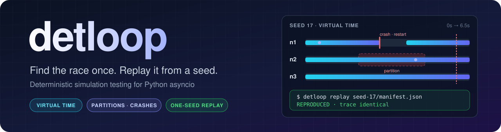
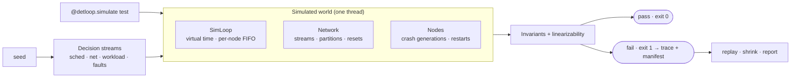
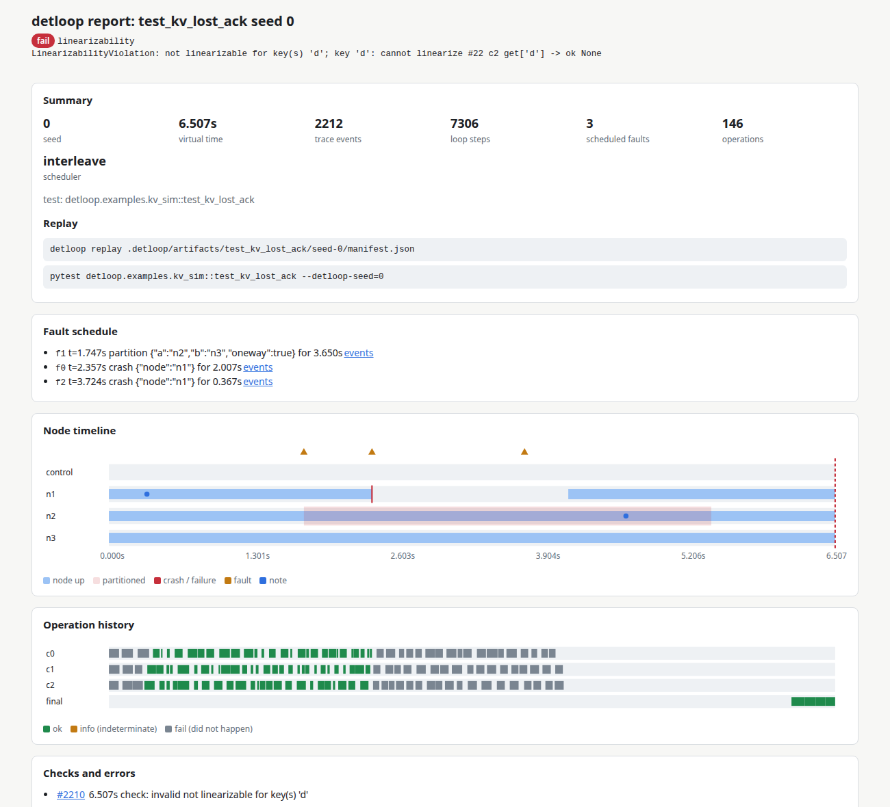

<p align="center">
  
</p>

<p align="center">
  <a href="https://github.com/raunaksahahere/detloop/actions/workflows/ci.yml"></a>
  <a href="https://pypi.org/project/detloop/"></a>
  <a href="https://pypi.org/project/detloop/"></a>
  
  
  <a href="LICENSE"></a>
  
</p>

<p align="center">
  <a href="#quickstart"><b>Quickstart</b></a> ·
  <a href="#why-detloop"><b>Why detloop</b></a> ·
  <a href="#how-it-works"><b>How it works</b></a> ·
  <a href="#measured-results"><b>Results</b></a> ·
  <a href="#limits-read-these"><b>Limits</b></a> ·
  <a href="#documentation"><b>Documentation</b></a>
</p>

---

**Run your asyncio services inside a simulated world, and replay any failure from a single seed.**

Races, lost messages and split brains are rare, timing-dependent and nearly impossible to
reproduce on a real event loop. **detloop** runs your ordinary asyncio code
(`asyncio.start_server`, `open_connection`, tasks, timeouts, aiohttp, httpx) on a custom event
loop with **virtual time**, a **simulated network** and **seeded** scheduling, partitions and
crashes. When a seed fails, the same seed fails the same way, every time, on any machine.

```console
$ detloop explore detloop.examples.kv_sim::test_kv_split_brain --seeds 300 --jobs 8
detloop: exploring detloop.examples.kv_sim::test_kv_split_brain seeds 0..299 with 8 job(s)
  seed 17: fail invariant:election-safety: InvariantViolation: invariant 'election-safety' violated: term 1 has two leaders: n1 and n2
  seed 43: fail invariant:election-safety: InvariantViolation: invariant 'election-safety' violated: term 1 has two leaders: n1 and n3
  ...
detloop: test_kv_split_brain: 300/300 seeds, 284 passed, 16 failed, 0 incomplete, 0 errors in 5.595s (53.62 seeds/s)
  canonical first failure: seed 17 (first discovered: seed 17)
  replay: detloop replay .detloop/artifacts/test_kv_split_brain/seed-17/manifest.json

$ detloop replay .detloop/artifacts/test_kv_split_brain/seed-17/manifest.json
replayed seed 17 (seeded decisions): fail invariant:election-safety
  REPRODUCED: same failure signature
  trace: identical (82b13f6395acec55 vs 82b13f6395acec55)
```

<sub>A real run: the bundled toy Raft-style KV store with a planted split-brain bug, CPython 3.12, 8 worker processes on a laptop.</sub>

## Four answers, and nothing in between

| Outcome | Exit | Meaning |
|---|:-:|---|
| ✅ **pass** | `0` | The test returned and no invariant failed, for every seed that ran. |
| ❌ **fail** | `1` | A seed broke something: assertion, invariant, linearizability, deadlock, starvation, node crash, or a call outside the determinism boundary. |
| ⚠️ **incomplete** | `3` | A budget ran out, the checker could not decide, or the wall-clock watchdog fired. **Never counted as a pass.** |
| 🛑 **error** | `5` | A detloop bug or a replay that diverged from its recording. |

Usage errors exit `2`, replay mismatches `4`. Full table: [docs/CLI.md](docs/CLI.md#exit-codes-stable).

## Why detloop

| | Feature | What it means |
|:-:|---|---|
| 🎲 | **One seed, one execution** | Scheduling, network latency, faults and workload randomness all come from seeded, recorded decision streams. A seed is a complete, shareable bug report. |
| ⏱️ | **Virtual time** | Integer-nanosecond clock that jumps to the next timer when nothing is runnable. Six seconds of heartbeats and timeouts take about 0.1 s of wall time. |
| 🌐 | **A network that misbehaves on purpose** | TCP-like streams with latency, bandwidth, flow control and `drain()` backpressure; partitions that stall and retransmit; resets; a lossy, reordering message bus. |
| 💥 | **Crashes that really stop code** | A crashed node's tasks never run again, even if they swallow `CancelledError`. Restarts get fresh memory and keep `node.disk`. |
| 🔍 | **Checkers built in** | Live invariants, operation histories and a bounded linearizability checker that answers valid, invalid or *unknown*. |
| ✂️ | **Shrink, replay, report** | Delta debugging removes faults and simplifies decisions; strict replay detects divergence; an offline HTML report shows the timeline. |
| 🛡️ | **Loud at the boundary** | Threads, subprocesses, real sockets, `time.sleep`, `os.urandom` and TLS fail the run instead of silently leaking real nondeterminism. |
| 🧪 | **Just pytest** | `@detloop.simulate` turns an `async def` test into a normal pytest test over a seed range; `--detloop-seed=17` replays one. |

### Compared with re-running a flaky test on real asyncio

Same KV workload, same checker, real loop with random 1–10 ms delays on every link
([benchmarks](docs/BENCHMARKS.md)):

| | Real asyncio + random sleeps | **detloop** |
|---|:---:|:---:|
| Reproduce a failure from a seed | ❌ | ✅ identical trace |
| Shrink a failure to fewer faults | ❌ | ✅ budget-bounded |
| Wall time per run of the 6.5 s scenario | ~6.5 s | ~0.11 s |
| Partitions, crashes, clock skew without extra infrastructure | ⚠️ proxies and scripts | ✅ built in |
| Deadlock reported with the blocked tasks | ❌ the test hangs | ✅ |
| Bugs caught per trial | comparable | comparable |
| Real kernel, real sockets, any library | ✅ | ⚠️ the simulated subset only |

## What it catches

detloop ships a small Raft-style replicated KV store (a teaching system, **not** production Raft)
with three independently selectable planted bugs. Each is found by exploration, replayed
exactly and shrunk; the corrected version passes every seed.

| Planted bug | What goes wrong | Caught by | Failing seeds (of 300) | First failing seed |
|---|---|---|---:|---:|
| `stale-read` | Followers answer reads from stale local state | 📊 linearizability checker | 199 (66%) | 1 |
| `lost-ack` | The leader acknowledges a write before a majority stores it | 📊 linearizability checker | 44 (15%) | 0 |
| `split-brain` | A node votes for two candidates in one term | 🚨 election-safety invariant | 16 (5%) | 17 |
| *corrected* | — | — | 0 | — |

<sub>CPython 3.12. Seed numbers differ on 3.11, whose asyncio schedules internal callbacks differently.</sub>

## How it works



1. **A custom event loop, not a patch.** `SimLoop` implements `asyncio.AbstractEventLoop` and is
   injected with `asyncio.Runner(loop_factory=...)`. Stdlib tasks, futures and streams run on it unchanged.
2. **Each node is its own loop.** Callbacks keep asyncio's registration order *within* a node; a
   recorded decision chooses *which* node runs next. That explores real cross-node races without
   producing executions asyncio itself could never produce.
3. **Every random choice is recorded.** Decisions go on per-stream tapes, so a failure can be replayed
   strictly (divergence is an error, never silently "fixed") and shrunk by re-executing candidates.
4. **The boundary is explicit.** Time, randomness, DNS and sockets are virtualized; threads,
   subprocesses, TLS and real I/O are rejected, and the rejection sticks even if your code catches it.

Details: [Architecture](docs/ARCHITECTURE.md) · [Determinism contract](docs/DETERMINISM.md) · [Fault model](docs/FAULT_MODEL.md).

## Install

```bash
pip install detloop          # standard library only, no runtime dependencies
pip install pytest           # for the pytest integration (the plugin registers itself)
```

Requires CPython 3.11, 3.12, 3.13 or 3.14 on Linux, macOS or Windows.

## Quickstart

**1. Write a simulation test.** A counter server and two clients that each read the value and
write it back plus one. On a real loop this usually "works":

<!-- example: examples/quickstart/test_counter.py -->
```python
import asyncio

import detloop


async def counter_server(node):
    value = 0

    async def handle(reader, writer):
        nonlocal value
        while line := await reader.readline():
            cmd, *arg = line.split()
            if cmd == b"SET":
                value = int(arg[0])
            writer.write(b"%d\n" % value)
            await writer.drain()
        writer.close()

    server = await asyncio.start_server(handle, port=7000)
    await server.serve_forever()


async def increment(host):
    reader, writer = await asyncio.open_connection(host, 7000)
    writer.write(b"GET\n")
    current = int(await reader.readline())
    writer.write(b"SET %d\n" % (current + 1))  # read-modify-write race
    await reader.readline()
    writer.close()


@detloop.simulate(nodes=1, seeds=200)
async def test_concurrent_increments(world):
    world.start(counter_server)
    await asyncio.sleep(0.1)
    await asyncio.gather(increment("n1"), increment("n1"))
    reader, writer = await asyncio.open_connection("n1", 7000)
    writer.write(b"GET\n")
    assert int(await reader.readline()) == 2, "lost update"
    writer.close()
```

**2. Run it with pytest.** detloop explores message timings and finds the lost update:

```console
$ pytest test_counter.py
E   detloop.errors.SimulationFailure: detloop: seed 0 fail (assertion:test_counter.py:39) after 1 of 200 seed(s)
E     AssertionError: lost update
E     virtual time 0.149417s, 78 steps, 0 scheduled fault(s)
E     manifest: <rootdir>/.detloop/artifacts/test_concurrent_increments/seed-0/manifest.json
E     replay:   pytest test_counter.py::test_concurrent_increments --detloop-seed=0
E               detloop replay <rootdir>/.detloop/artifacts/test_concurrent_increments/seed-0/manifest.json
```

The fixed version, [`test_counter_fixed.py`](examples/quickstart/test_counter_fixed.py),
increments atomically on the server and passes all 200 seeds even with latency faults.

**3. Explore, replay, shrink, report**

```bash
detloop explore tests/sim_test.py --seeds 10000 --jobs 8          # many seeds, many processes
detloop replay  .detloop/artifacts/test_x/seed-17/manifest.json   # same seed, same trace
detloop shrink  .detloop/artifacts/test_x/seed-17/manifest.json   # fewer faults, simpler decisions
detloop report  .detloop/artifacts/test_x/seed-17-shrunk/manifest.json -o report.html
pytest tests/sim_test.py --detloop-seed=17                         # or replay inside pytest
```

> [!TIP]
> **Add faults and invariants.** `@detloop.simulate(nodes=3, seeds=2000, faults="partitions,crashes")`
> generates a fault schedule from the seed. Check properties live with
> `world.invariant("one-leader", lambda: leaders() <= 1)`, record client operations in
> `world.history`, and finish with `assert_linearizable(world.history, KVModel())`.
> Walkthrough: [docs/GETTING_STARTED.md](docs/GETTING_STARTED.md).

<details>
<summary><b>What does a node look like?</b> (click to expand)</summary>

Node code is plain asyncio. The node gets an address (`n1` → `10.0.0.1`), a name other nodes can
resolve, a `disk` dict that survives crashes and a fresh `volatile` dict per incarnation:

```python
async def server(node):
    node.disk.setdefault("term", 0)          # survives crash/restart
    srv = await asyncio.start_server(handle, port=7000)
    await srv.serve_forever()

@detloop.simulate(nodes=3, seeds=500, faults="partitions,crashes")
async def test_cluster(world):
    world.start(server)                       # runs server(node) on n1..n3
    world.partition("n1", ["n2", "n3"])       # explicit faults work too
    world.crash("n2", restart_after=1.0)      # restart reruns server(node)
    ...
```

API reference: [docs/API.md](docs/API.md).
</details>

## See the failure

Every failing seed gets a self-contained HTML report: node timeline with crashes and partitions,
operation history, checker results and a filterable, linked event table. No CDN, no server; trace
text is embedded as inert JSON under a hash-pinned Content-Security-Policy.

<p align="center">
  
  <br>
  <sub>The <code>lost-ack</code> failure at seed 0. Open the real file: <a href="docs/sample-report-lost-ack.html">docs/sample-report-lost-ack.html</a> (download and open locally).</sub>
</p>

<!-- RESULTS:BEGIN -->
## Measured results

AMD Ryzen 5 5600H laptop, 12 logical CPUs, CPython 3.12, on the release code. Raw data:
[benchmarks/results](benchmarks/results/) · method and caveats: [docs/BENCHMARKS.md](docs/BENCHMARKS.md).

| | |
|---|---|
| ⚡ Throughput (KV scenario, 6.5 s of virtual time per seed) | **8.7 seeds/s** per process · **51 seeds/s** with 12 workers |
| 🔁 Determinism | Identical trace hashes in fresh processes under 3 hash seeds; serial and parallel runs agree per seed |
| 🌍 Cross-platform | Declared fixture **byte-identical** across Linux, macOS and Windows × CPython 3.11–3.14 (12 CI jobs, 20/20 seeds) |
| 📐 Checker | Agrees with an independent brute-force oracle on 1,500 generated + 675 exhaustive histories |
| 🧾 Trace overhead | `basic` (default): within noise for pure scheduling, ~22% on the network-heavy KV scenario |
| ✂️ Shrinking | Faults removed: lost-ack 3 → 1, split-brain 1 → 0; decision shrinking stops on its run budget |
| 🧱 Baseline | Real asyncio + random sleeps: stale reads 18/20, lost writes 3/20, split brain 0/20 trials, ~6.5 s each, not replayable |
<!-- RESULTS:END -->

## Use it in CI

A failing seed exits non-zero, so a plain workflow step is enough:

```yaml
- run: pip install detloop pytest
- run: pytest tests/                    # each @detloop.simulate test runs its seed range
- run: detloop explore tests/sim_test.py --seeds 2000 --jobs 4 --json --summary-file detloop-summary.json
- uses: actions/upload-artifact@v7
  if: failure()
  with:
    name: detloop-artifacts
    path: .detloop/                     # traces + manifests: replay any failure locally
```

<details>
<summary><b>More: Python API, compatibility, determinism checks</b></summary>

**Python API**

```python
import detloop
from detloop.explore import explore

spec = detloop.get_spec(test_concurrent_increments)    # the decorated test
result = detloop.run(spec.fn, seed=17, config=spec.config)
print(result.status, result.signature, result.trace_sha256)
summary = explore(spec, range(1000)).summary()          # canonical first failure, signatures, ...
```

**Libraries over the simulated network** (real traffic, no mocks): aiohttp 3.14 client and
server, httpx 0.28 `AsyncClient`. httpx reconnects per request over simulated sockets (its pool
check needs a real file descriptor). Details: [docs/COMPATIBILITY.md](docs/COMPATIBILITY.md).

**Catch nondeterminism in your own code**: `detloop explore ... --verify-determinism 20` re-runs
seeds in fresh processes with different hash seeds and compares trace hashes.

**CLI**: `detloop explore | replay | shrink | report`. Reference: [docs/CLI.md](docs/CLI.md).

</details>

## Limits (read these)

> [!IMPORTANT]
> A passing run means **"no failure found in these seeds"**, not "correct".

- **Not a sandbox.** Guards cover documented routes (time, entropy, sockets, threads,
  subprocesses, TLS). C extensions, cached aliases (`from time import monotonic`), `datetime.now()`
  and direct system calls are not intercepted. Only run code you trust.
- **A narrow simulated subset.** No TLS, IPv6, UNIX sockets, datagram endpoints, executors or disk
  model. These raise clear errors rather than falling back to the real thing. `node.disk` is a dict
  that is durable on assignment, not an fsync model.
- **Within one node, tasks are not reordered** (asyncio's FIFO order is kept); races inside a single
  node are explored through timing only, unless you opt into the `relaxed` scheduler.
- **Seeds are tied to code, config and Python minor version.** Replay checks this and warns or refuses.
  Byte-identical traces across Python versions are not promised in general.
- **Shrinking is budget-bounded** and never claims a minimal result. **Module-level state** in test code
  persists between seeds in one worker (use `--fresh-process`).

More: [docs/IMPLEMENTATION_STATUS.md](docs/IMPLEMENTATION_STATUS.md#known-limitations-by-design-in-010) · [docs/ROADMAP.md](docs/ROADMAP.md).

## Documentation

| Guide | Contents |
|---|---|
| 🚀 [Getting started](docs/GETTING_STARTED.md) | Write, run, explore, replay, shrink, check |
| 📖 [API](docs/API.md) · [CLI](docs/CLI.md) | Decorator, World, Node, checkers, commands, exit codes |
| 🏗️ [Architecture](docs/ARCHITECTURE.md) | Modules, data flow, lifecycle, extension points |
| 🎲 [Determinism](docs/DETERMINISM.md) | Replay contract, PRNG streams, ordering rules, what is and is not covered |
| 🌐 [Fault model](docs/FAULT_MODEL.md) | Streams vs messages, partitions, crashes, clock skew |
| 🧾 [Trace format](docs/TRACE_FORMAT.md) | JSONL schema, manifests, SQLite |
| 🔌 [Compatibility](docs/COMPATIBILITY.md) · [Troubleshooting](docs/TROUBLESHOOTING.md) | Supported asyncio features and libraries; fixes |
| 🧪 [Testing](docs/TESTING.md) · [Benchmarks](docs/BENCHMARKS.md) | Test layers, oracles, raw results |
| 🧭 [Design decisions](docs/DESIGN_DECISIONS/README.md) · [Roadmap](docs/ROADMAP.md) · [Status](docs/IMPLEMENTATION_STATUS.md) | Why it is built this way, and what is next |
| 📦 [Releasing](docs/RELEASING.md) · [Maintenance](docs/MAINTENANCE.md) · [Tech stack](docs/TECH_STACK.md) · [Changelog](CHANGELOG.md) | Project operations |

## Development

<details>
<summary><b>Build, test and project layout</b></summary>

```bash
git clone https://github.com/raunaksahahere/detloop && cd detloop
uv sync --group dev --extra compat
uv run pytest                               # ~45 s; compat tests need the extra
uv run ruff format --check src tests && uv run ruff check src tests && uv run mypy
uv run python scripts/check_docs.py         # links, anchors, embedded examples
python benchmarks/bench.py --quick          # benchmarks (never a CI gate)
```

| Path | Role |
|---|---|
| [`src/detloop/loop.py`](src/detloop/loop.py) | The simulated event loop |
| [`src/detloop/net/`](src/detloop/net) | Simulated network: streams, servers, sockets, messages |
| [`src/detloop/world.py`](src/detloop/world.py) | Nodes, crashes, faults, invariants |
| [`src/detloop/checker/`](src/detloop/checker) | Linearizability checker and models |
| [`src/detloop/explore.py`](src/detloop/explore.py) · [`shrink.py`](src/detloop/shrink.py) · [`replay.py`](src/detloop/replay.py) | Exploration, shrinking, replay |
| [`src/detloop/examples/`](src/detloop/examples) | The toy KV store and its planted bugs |

Contributing: [CONTRIBUTING.md](CONTRIBUTING.md) · Security: [SECURITY.md](SECURITY.md)

</details>

<div align="center">

<br />

**Built by [Raunak Saha](https://github.com/raunaksahahere)** · [MIT License](LICENSE)

⭐ If detloop helps you find a bug, a star on the repo goes a long way.

</div>
