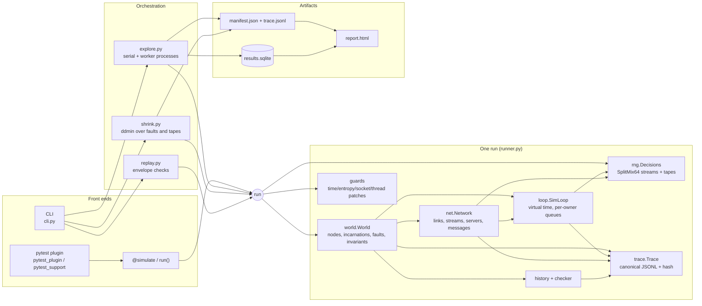

# Architecture

## Overview

## Modules

| Module | Responsibility |
|---|---|
| `loop.py` | `SimLoop`, a direct `asyncio.AbstractEventLoop` implementation: integer-ns virtual clock, timer heap with stable tie-breakers, per-owner ready queues and iterations, scheduler modes, budgets, deadlock/starvation detection, deterministic task names, async-generator hooks, explicit `UnsupportedOperation` for out-of-scope APIs |
| `_owner.py` | The `OWNER` context variable and owner tokens; ownership propagates through asyncio's own context handling |
| `_compat.py` | The few CPython private details relied upon, with version notes |
| `world.py` | `World`, `Node`, `Incarnation`: lifecycle, crash epochs, restart factories, `disk`/`volatile`, clock skew, partitions/heal API, fault-schedule application, invariants |
| `net/network.py` | Addressing and simulated DNS, directed links with reference-counted blocks, latency/bandwidth, connection establishment, data transfer state machine (stall/retransmit/timeout), resets, crash handling, message bus routing |
| `net/stream.py` | `SimTransport` (`asyncio.Transport`), endpoints, directions, flow control |
| `net/server.py` | `SimServer` (`asyncio.AbstractServer`) with version-faithful `wait_closed` |
| `net/socket.py` | `SimSocket` (what `socket.socket()` returns inside a simulation) and socket views for `get_extra_info("socket")` |
| `net/messages.py` | Datagram-style message endpoints |
| `rng.py` | Stream derivation, SplitMix64, decision tapes (seeded/strict/guided), `SimRandom` |
| `faults.py` | `Fault` records and up-front random schedule generation |
| `guards.py` | Scoped, reference-counted patches of time, entropy, sockets, threads, processes and TLS; per-thread activation |
| `history.py` | Operations with invoke/complete logical order and ok/fail/info/pending status |
| `checker/linearizability.py` | `Model` interface, `RegisterModel`, `KVModel`, bounded WGL search |
| `trace.py` | Canonical event serialization, sanitization, incremental hash |
| `runner.py` | One run: build world, generate faults, install guards and watchdog, drive `asyncio.Runner(loop_factory=...)`, classify the outcome, deterministic teardown |
| `api.py` | `@simulate`, `Spec`, configuration building |
| `explore.py` | Seed exploration, worker supervision, cutoff, aggregation |
| `shrink.py` | Delta debugging and strict-replay verification |
| `replay.py` | Manifest loading, envelope checks, replay |
| `artifacts.py` | Manifests, atomic writes, SQLite schema |
| `report.py` + `report_assets/` | Offline HTML report |
| `targets.py` | Target parsing, importing, workload fingerprints |
| `pytest_plugin.py`, `pytest_support.py` | pytest options and in-process execution of specs |
| `cli.py` | `detloop` command |
| `examples/` | Shipped toy KV store and its simulation tests |

## Control and data flow of one run

1. **Setup** (`runner.run`): create `Decisions(seed)`, a `Trace`, and a
   `World`, which creates the `SimLoop` and `Network` and registers nodes.
   Generate the fault schedule from the `faults` stream (or take an explicit
   one) and write the trace header.
2. **Isolation**: collect garbage and disable the cyclic GC, start the
   wall-clock watchdog, then install guards for this thread.
3. **Execution**: `asyncio.Runner(loop_factory=lambda: loop).run(main())`
   where `main` installs fault timers, awaits the user's test function, and
   checks registered invariants. The test body runs in a control-owned
   context; nodes run in contexts carrying their incarnation.
4. **Scheduling**: each `SimLoop` step picks an owner (recorded decision if
   more than one is runnable), starts that owner's next iteration if its batch
   is exhausted, and runs one handle. Handles of dead owners are dropped.
   When nothing is runnable, time jumps to the next timer; with no timers and
   an unfinished main task, the run is a deadlock.
5. **Network**: `create_connection`/`create_server` are served by `Network`.
   Packet arrivals are timers owned by the receiving incarnation, so a crash
   drops them; senders' retransmission timers are owned by the sender.
6. **Classification**: the outcome (`pass/fail/incomplete/error`, kind,
   signature) is derived from the exception (or absence of one) that ended
   `main`, or from an abort recorded by `world.check`, guards, node errors or
   budgets. The `end` event is traced and the trace is sealed.
7. **Teardown** (not traced): frozen coroutines of crashed nodes are closed,
   remaining tasks are cancelled in creation order with a step budget,
   leftovers are closed explicitly, transports are closed, the loop is closed,
   guards are removed and the GC is restored.

## Lifecycle of a node

`new` → `start(factory)` → `up` (incarnation `#1`) → `crash()` → `down` →
`restart()` → `up` (incarnation `#2`) ... A factory that returns leaves the
incarnation alive (its spawned tasks and servers keep running); a factory
that raises is a node error (fails the run unless `fail_on_node_error=False`).

## Extension points

- **Models** for the checker: subclass `checker.Model`.
- **Invariants**: `world.check`, `world.invariant`.
- **Workload randomness**: `world.rng`.
- **Custom trace events**: `world.note` (shown in the report).
- **Explicit fault schedules**: `detloop.run(..., faults=[Fault(...)])`.
- **Programmatic exploration**: `detloop.explore.explore`, `detloop.shrink.shrink`.

## Why these boundaries

See the ADRs in [DESIGN_DECISIONS](DESIGN_DECISIONS/README.md): a custom loop
instead of `BaseEventLoop` patching (0001), per-owner FIFO scheduling (0002),
stream versus message faults (0003), ownership and crash generations (0004),
the linearizability checker (0005), replay and shrinking (0006), and version
support (0007).
